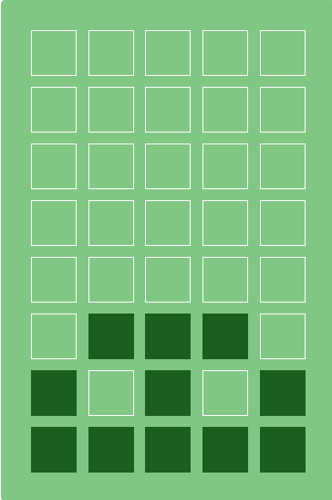
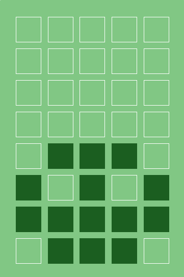
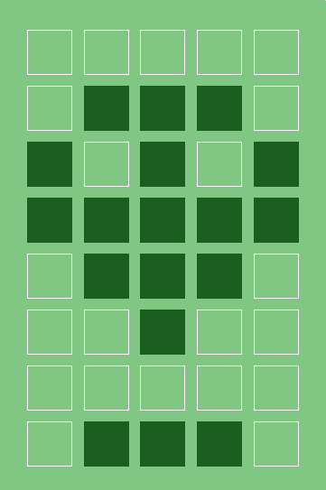
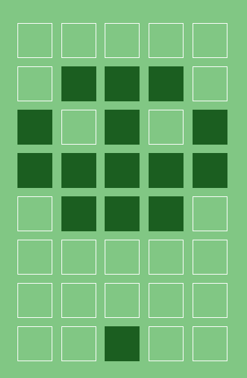
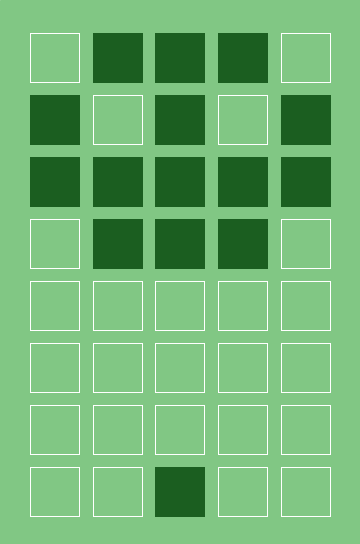
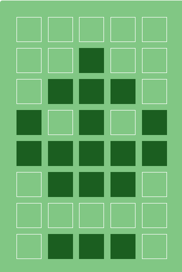
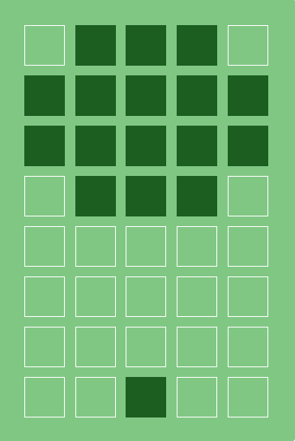
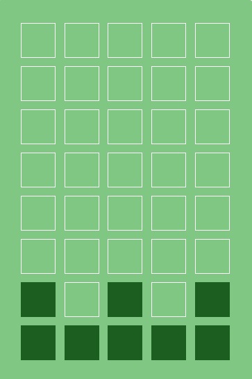
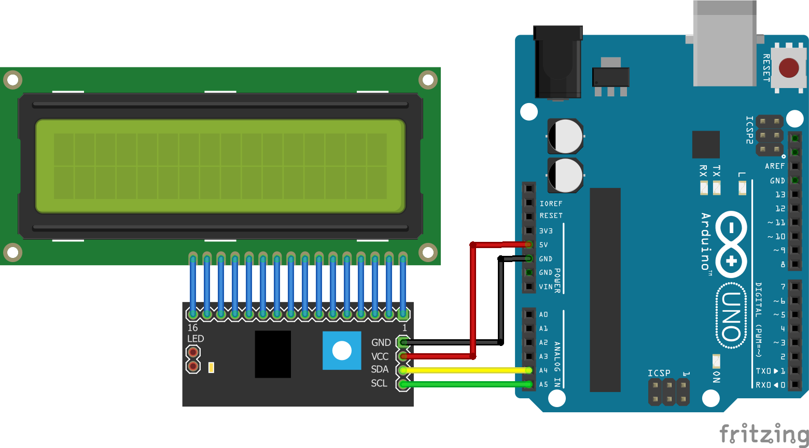
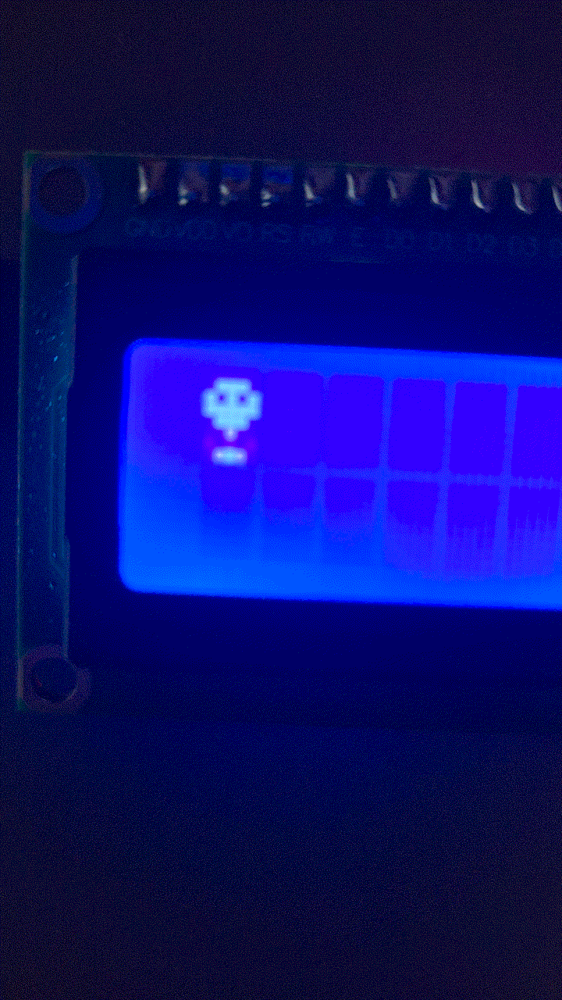

# LCD 16x2 동작 표시 캐릭터

LCD 16x2의 첫째 줄 첫 글자 한 칸에서 공 캐릭터가 통통 튀어 오르며 아두이노가 동작 중임을 알려줍니다.

- 공이 튀고 있으면 → 아두이노가 정상 동작 중
- 공이 한 자세로 멈춰 있으면 → 프로그램이 멈춤(행/리셋 대기 등)

---

## 1. 아이디어

로딩 표시는 보통 회전하는 막대나 점이지만, 한 칸짜리 공간에도 살아 있는 느낌을 주고 싶었습니다.

착지할 때 납작하게, 도약·낙하할 때 길쭉하게 그려 말랑한 질감과 속도감을 표현했습니다.
바닥·최고점에서는 오래, 빠르게 움직이는 구간은 짧게 시간을 두어 중력처럼 보이는 움직임을 구현했습니다.

여기에 공중에 있을 때 바닥에 그림자를 두어(높이에 따라 크기 변화) 얼마나 높이 떠 있는지 보이게 했고, 착지 순간 철퍽 퍼지는 모션과 4번 튈 때마다 최고점에서 눈을 깜빡이는 모션으로 자연스러움을 표현했습니다.

## 2. 캐릭터 디자인 (Custom Character)

[LCD Character Creator](https://maxpromer.github.io/LCD-Character-Creator/)로 8개 모션 `c0` ~ `c7`을 만들어 CGRAM 슬롯 0~7(8칸 전부)에 저장했습니다.

```
        

```

- 도약할 때는 꼬리가 아래(`c2`), 낙하할 때는 꼬리가 위(`c5`)로 가서 진행 방향이 보입니다.
- 맨 아래 줄은 그림자입니다.

### 재생 순서와 시간

1. c7 철퍽 70ms 착지 충격으로 납작하게 퍼짐
2. c0 찌그러짐 130ms 반동으로 살짝 솟으며 웅크림 (힘 모으기)
3. c1 바닥 60ms 원래 모양으로 복원
4. c2 도약 60ms 빠르게 도약
5. c3 중간 90ms 감속하며 상승
6. c4 최고점 (4번마다 c6 깜빡) 200ms 최고점 체공
7. c3 중간 90ms 가속하며 하강
8. c5 낙하 60ms 빠르게 낙하 → 1로

한 번 튀는 데 약 760ms. 너무 빠르면 LCD 잔상으로 뭉개지고, 너무 느리면 동작 중이라는 느낌이 약해서 여러 번 조정한 값입니다.

## 3. 연결도




## 4. 스케치

전체 코드: [lcd.ino](lcd/lcd.ino)

핵심 부분:

```cpp
byte c0[] = { B00000, B00000, B00000, B00000, B00000, B01110, B10101, B11111 };
// ... c1 ~ c7 같은 방식

const byte seq[] = { 7,  0,   1,  2,  3,   4,  3,  5 };  // c7 → c0 → c1 → c2 → c3 → c4 → c3 → c5
const int  dur[] = { 70, 130, 60, 60, 90, 200, 90, 60 }; // 각 모션 유지 시간(ms)

void setup() {
  lcd.init();
  lcd.backlight();
  lcd.createChar(0, c0);
  // ... createChar(1, c1) ~ createChar(7, c7)
  lcd.clear();
}

void loop() {
  if (millis() - lastFrame >= dur[step]) {   // 현재 모션 유지 시간이 지나면
    lastFrame = millis();
    step = (step + 1) % SEQ_LEN;             // 다음 모션으로
    if (step == 0) bounceCount++;

    byte f = seq[step];
    if (f == 4 && bounceCount % 4 == 3) f = 6;  // 4번마다 최고점에서 눈 깜빡

    lcd.setCursor(0, 0);                     // 첫째 줄 첫 칸
    lcd.write(f);
  }
}
```

- `delay()` 대신 `millis()`로 시간을 재서, 나중에 `loop()`에 다른 작업을 추가해도 애니메이션이 멈추지 않습니다.
- 프레임마다 다른 시간(`dur[]`)을 써서 자연스러운 동작을 구현했습니다.

## 5. 데모



## 6. 고찰

1. **한 칸에서 부드러운 동작을 만드는 방법**
   5×8 픽셀은 위치를 1픽셀씩만 옮길 수 있어 프레임 수를 늘리는 데 한계가 있었습니다. 대신 프레임마다 표시 시간을 다르게 주니 모션은 8개뿐인데도 훨씬 자연스러워졌습니다. 같은 시간 간격으로 재생했을 때는 기계적으로 위아래로 움직이는 느낌이었습니다.

2. **모양 변화가 위치 변화를 보완**
   위치만 바뀌면 뚝뚝 끊겨 보였지만, 찌그러짐과 도약 단계 동작과 꼬리 방향으로 진행 방향을 표현한 것이 효과가 있었습니다.

3. **LCD의 응답 속도**
   문자 LCD의 액정은 반응이 느려 프레임을 약 50ms보다 짧게 하면 잔상 때문에 형체가 흐려졌습니다. 그래서 가장 짧은 프레임을 60ms로 두었습니다.

4. **동작 표시로서의 의미**
   `delay()`로 만들면 애니메이션이 다른 작업을 막거나, 다른 작업이 오래 걸리면 캐릭터가 멈춥니다. `millis()` 방식은 `loop()`가 정상적으로 돌고 있을 때만 캐릭터가 움직이므로, 캐릭터가 멈추면 프로그램이 멈췄다는 신호가 되어 동작 표시 본래의 목적에 맞습니다.

5. **`createChar()`**
   `createChar()` 후에는 LCD 내부 주소가 CGRAM을 가리키고 있어서 바로 `print()`하면 글자가 화면 대신 CGRAM에 써집니다. 그래서 출력 전에는 항상 `setCursor()`를 호출했습니다.

6. **확장 아이디어**
   이번에 CGRAM 슬롯 8개를 모두 사용했지만, 같은 슬롯에 `createChar()`로 매 프레임 새 모양을 덮어쓰면 프레임 수 제한 없이 애니메이션을 만들 수 있습니다. 센서 값이나 오류 상태에 따라 튀는 속도나 표정을 바꾸면 상태 표시로도 활용할 수 있습니다.
